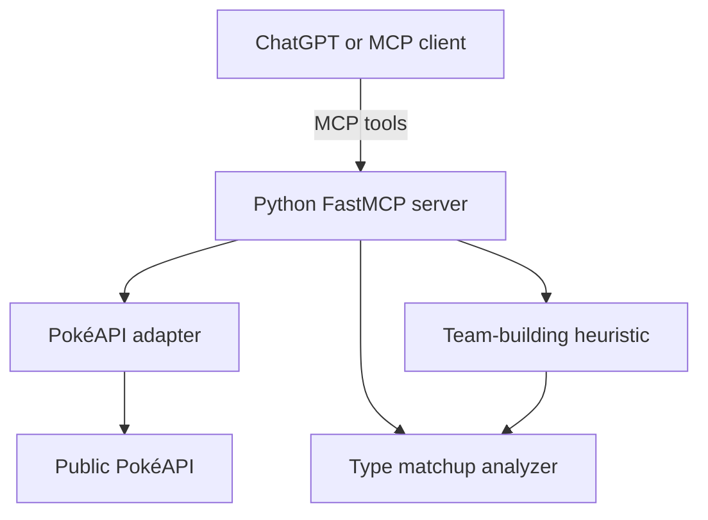

# Pokémon MCP Team Builder

**A Python Model Context Protocol (MCP) server that lets ChatGPT retrieve live Pokémon data, explore team compositions, and explain type-based weaknesses.**

> **Project status:** Educational prototype with working data retrieval and explainable team suggestions. It is **not** a competitive legality checker or battle simulator. Suggested teams are not guaranteed legal or optimal for a specific metagame.

## The problem

Pokémon information is scattered across reference websites, and building a balanced six-member team requires comparing types, roles and weaknesses. This project connects an AI assistant to a real data source and adds deterministic analysis tools so users can ask questions in natural language.

## What it does

| Capability | How it works | Status |
| --- | --- | --- |
| Live Pokémon stats, types and abilities | Fetches data from PokéAPI | Implemented |
| Move discovery | Lists recorded moves with a legality disclaimer | Implemented |
| Team suggestions | Deterministic role and type heuristic over a curated roster | Implemented (demo) |
| Team weakness analysis | Calculates type matchups and shared weaknesses | Implemented |
| Original six-Pokémon demo | Preserves the tutorial tools for backward compatibility | Implemented |
| Official format legality and Showdown exports | Requires a maintained rules source and set validator | Future work |
| Battle simulations or real win rates | Requires a full battle engine and evaluation methodology | Future work |

## Quick demonstration

```text
User: Use Pokémon MCP to show Greninja's stats.
Assistant: [calls get_pokemon_info] Greninja is Water/Dark ...

User: Suggest a balanced example team around Greninja.
Assistant: [calls suggest_example_team] Here is a six-member example,
           each role, and an explanation of shared type weaknesses.

User: Is this guaranteed legal in Gen 9 OU?
Assistant: No. This version does not validate tier or moveset legality.
```

For an offline demo that requires **no account, API key or network**:

```bash
python -m scripts.demo
```

## Architecture



The app separates transport (`pokemon_mcp/app.py`), external API access (`pokemon_mcp/pokeapi.py`), type calculations (`pokemon_mcp/type_chart.py`), and team-building logic (`pokemon_mcp/team_builder.py`). This makes the rules testable without ChatGPT or a live API. See [architecture notes](docs/ARCHITECTURE.md).

## Run locally

Requirements: Python **3.11+**.

```bash
python3 -m venv .venv
source .venv/bin/activate             # Windows PowerShell: .venv\Scripts\Activate.ps1
python -m pip install -e '.[dev]'
python -m pytest -q
python server.py
```

The Streamable HTTP MCP endpoint is `http://localhost:8000/mcp`; the health route is `http://localhost:8000/health`. Use the `/mcp` endpoint with an MCP-compatible client. A localhost URL is not accessible to cloud-hosted ChatGPT.

To use local STDIO transport, run `MCP_TRANSPORT=stdio python server.py`.

## Deploy on Render

This standalone project deploys as a separate Render service named `pokemon-mcp-team-builder`. It exposes `/health` and `/mcp` and starts through `server.py`. Create a new Render Blueprint connected to this repository; the original Pokémon MCP service is independent.

1. Deploy from this repository using the included Docker configuration.
2. Check `https://YOUR-RENDER-URL/health` returns `status: ok`.
3. Connect an MCP client to `https://YOUR-RENDER-URL/mcp`.
4. Verify that the client discovers all the tools below.

Free-tier instances may need a cold start. No PokéAPI key or OpenAI API key is required. The server is publicly reachable and currently unauthenticated: **do not extend it to private user data without authentication and access controls.**

## MCP tools

| Tool | Description |
| --- | --- |
| `get_pokemon_info(name)` | Live stats, typing, abilities |
| `get_pokemon_moves(name, limit=30)` | Historically recorded moves; no format legality guarantee |
| `suggest_example_team(core="greninja", playstyle="balanced")` | Six-member educational team suggestion; curated candidate pool |
| `list_team_candidates()` | Names and roles accepted by the example builder |
| `analyze_team(pokemon_names)` | Fetch live typings and analyze 1–6 comma-separated names |
| `create_tournament_squad()` | Original tutorial's fixed six-member demonstration |
| `list_popular_pokemon()` | Original tutorial's fixed popularity list |

An `analyze_team` example input:

```text
Greninja, Corviknight, Garchomp
```

The analysis reports type weaknesses and resistances only. It does not account for Pokémon abilities, items, moves, Tera types, battle format rules, or turn-by-turn gameplay.

## Code quality and tests

Run `python -m pytest -q` to run offline unit tests using HTTP mocks. Run `python -m ruff check pokemon_mcp server.py tests scripts` to check style. GitHub Actions runs these checks for each push and pull request. See [validation guide](docs/TESTING.md) for coverage and live checks. Tests do **not** prove that suggested teams win battles or are tournament legal.

## Portfolio / interview talking points

- **Integration:** Built a remote MCP server and connected an LLM interface to PokéAPI.
- **Software design:** Separated networking, tool definitions, algorithms and tests into modules.
- **Algorithms:** Developed explainable team selection using role coverage and overlapping type weaknesses.
- **Engineering:** Added deterministic tests, mock HTTP responses, CI and deployment documentation.
- **Tradeoffs:** Explicitly scoped the prototype; avoided fabricating competitive legality or win rates.

See [live demo script](docs/DEMO.md) and [project roadmap](docs/ROADMAP.md).

## Attribution

Started as an adaptation of the 2MinutesPy "Building an MCP server in 2 minutes" demonstration. The original demo's three tool names are preserved for compatibility; the modular architecture, team-analysis utilities, tests, and expanded documentation are project enhancements.

- [Original tutorial inspiration](https://github.com/Sachin-crypto/Pokemon-MCP-Server)
- [PokéAPI](https://pokeapi.co/)
- [Model Context Protocol](https://modelcontextprotocol.io/)

This is an unofficial fan developer project and is not affiliated with The Pokémon Company, Nintendo or Game Freak.
