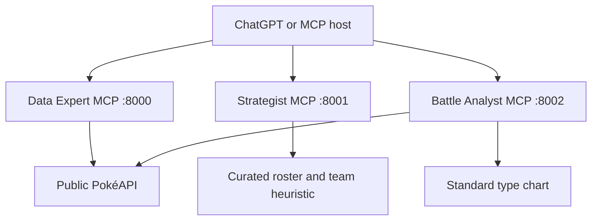

# Architecture

The arrows from the host represent separate MCP connections. The host passes the
Strategist's typed `team` array into the Analyst's `analyze_team_types` tool.
There are no implicit server-to-server calls and no in-service LLM. Live lookups
are optional for the offline suggestion/typed-analysis path.

## Modules

- `app.py`: tool handlers and `create_server` factory. Each factory call owns an
  independent registry and exposes only three tools for its specialist.
- `data_server.py`, `strategist_server.py`, `analyst_server.py`: independent entry
  points for HTTP or STDIO clients.
- `pokeapi.py`: validated external API adapter and response summaries.
- `team_builder.py`: deterministic role coverage and greedy weakness heuristic
  over a curated candidate roster. Styles change role selection order.
- `type_chart.py`: standard defensive multiplier calculations without network I/O.
- `server.py`: Docker/Render selector using `MCP_SERVICE`.

Each process owns its HTTP lifecycle and session manager. Local default ports
are 8000/8001/8002. Render runs three containers on internal port 8000 with distinct
public URLs. Each has `/mcp` and `/health`; health reports process readiness,
not external API availability.

Shared code avoids duplicated type rules while deployment and tool discovery stay
independent. This creates a protocol/schema compatibility responsibility: consumers
must pass a list of unique named entries with one or two valid types to the Analyst.
Invalid input produces a readable tool response. Errors are not evidence of valid
analysis; callers must inspect the returned result.

## Limits

The roster's roles are illustrative. No format eligibility, moveset legality,
abilities, items or battle simulation is implemented. External API timeouts and
malformed responses become service errors. Public endpoints are unauthenticated.
Three-service orchestration demonstrates architecture and contracts rather than
improved competitive strength.
